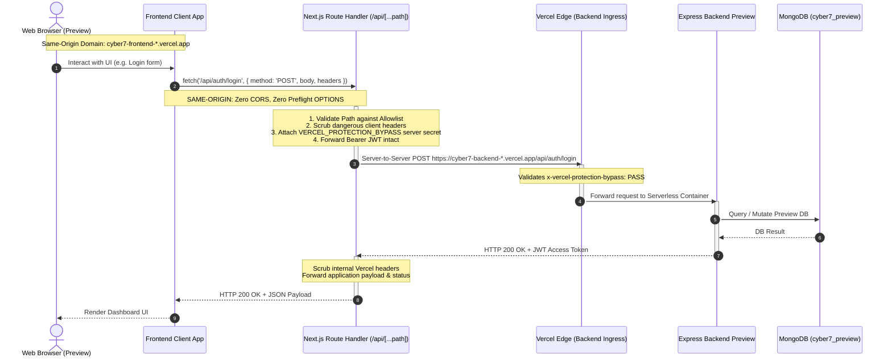

# VexChat Phase 6 — Step 17: Secure Preview Proxy Architecture Design

**Date:** Mon Nov 2 2026  
**Project:** VexChat (Frontend & Backend Alignment)  
**Mode:** READ-ONLY ARCHITECTURAL DESIGN — NO IMPLEMENTATION EXECUTED  
**Frontend Repository:** `D:\Client-project\client-2\cyber7-frontend`  
**Backend Repository:** `D:\Client-project\client-2\cyber7-backend`  
**Frontend Preview URL:** `https://cyber7-frontend-nz25f8vwy-md-limons-projects-283c7c6c.vercel.app`  
**Backend Preview API:** `https://cyber7-backend-l48kp7h5h-md-limons-projects-283c7c6c.vercel.app/api`  
**Preview Database:** `cyber7_preview` (Isolated from Production `cyber7`)  

---

## 1. Executive Summary & Design Recommendation

### The Core Problem
During Step 15 E2E testing and Step 16 investigation, browser-based communication between the Frontend Preview and Backend Preview was blocked by two layers:
1. **Vercel Edge Deployment Protection:** Unauthenticated cross-origin browser `OPTIONS` preflight requests are intercepted at Vercel's ingress layer, returning `HTTP 302 Found` redirects without CORS headers. Under the W3C / WHATWG Fetch specification, preflight requests cannot carry cookies, and any redirect on a preflight causes an immediate browser CORS violation.
2. **Static Backend CORS Mismatch:** The Express backend CORS configuration strictly checks `process.env.CLIENT_URL` (currently set to the production URL `https://cyber7-frontend.vercel.app`), rejecting calls originating from the dynamic preview URL `https://cyber7-frontend-nz25f8vwy-md-limons-projects-283c7c6c.vercel.app`.

### The Recommended Architecture: Option B (Next.js Server-Side Route Handler Proxy)
We recommend **Option B: Next.js Server-Side API Proxy (Route Handler)** as the definitive, secure architecture.



### Why Option B Outperforms All Alternatives
* **Zero Weakening of Security:** Keeps Vercel Deployment Protection **100% active** on BOTH the Frontend and Backend Preview environments. The backend is never exposed to the public internet.
* **Complete Elimination of CORS:** Because browser requests target `/api/*` on the exact same origin as the frontend application, the browser never generates cross-origin preflight `OPTIONS` requests.
* **Zero Changes to Backend Codebase:** Operates entirely within the frontend repository (`cyber7-frontend`). No modifications to `cyber7-backend` CORS rules, branches, or deployments are required.
* **Strict Secret Isolation:** The Vercel bypass token is stored exclusively in a server-side environment variable (`VERCEL_PROTECTION_BYPASS`). It is never prefixed with `NEXT_PUBLIC_`, never bundled into client JavaScript, never present in source maps, and never exposed in HTTP response headers.
* **Zero Production Drift:** In Production, the proxy can be bypassed or disabled. The client application continues to call the public production backend directly, preserving production isolation.

---

## 2. Comparative Evaluation of Architectural Approaches

### 2.1 Option A — Browser SSO Session
* **Concept:** Rely on an active Vercel SSO session in the user's browser across both domains.
* **Technical Analysis & Fatal Flaws:**
  1. **Preflight Credential Exclusion:** Section 4.4 of the W3C / WHATWG Fetch specification mandates: *“The request’s credentials mode is 'omit' for preflight requests.”* Modern browsers will never transmit cookies (`_vercel_jwt`) on preflight `OPTIONS` requests.
  2. **Illegal Preflight Redirects:** Because the preflight carries no cookies, Vercel Edge issues an `HTTP 302 Found` redirect. The Fetch standard specifies that any non-2xx status code on a preflight causes the fetch to fail immediately.
  3. **Third-Party Cookie Deprecation:** Even for simple requests without preflight, cross-site cookies between distinct subdomains (`cyber7-frontend-*.vercel.app` and `cyber7-backend-*.vercel.app`) are partitioned or blocked by modern browser privacy sandboxes (CHIPS / Storage Access API).
* **Verdict:** **TECHNICALLY INFEASIBLE.** Cannot function in any standard web browser.

---

### 2.2 Option B — Next.js Server-Side API Proxy (Route Handler vs. Rewrite)
* **Concept:** Next.js server runtime acts as a reverse proxy, forwarding requests server-to-server to the protected backend with the bypass secret.
* **Route Handler (`app/api/[...path]/route.ts`) vs. Next.js Rewrite (`next.config.ts`):**

| Architectural Dimension | Next.js Rewrite (`rewrites()` in `next.config.ts`) | Next.js Route Handler (`app/api/[...path]/route.ts`) |
| :--- | :--- | :--- |
| **Execution Layer** | Edge Routing / Reverse Proxy | Node.js Serverless Function Runtime |
| **Dynamic Secret Injection** | Difficult/Fragile; config files cannot reliably evaluate dynamic runtime secrets without build-time inlining risks | **Trivial & Secure:** `process.env.VERCEL_PROTECTION_BYPASS` evaluated dynamically per request |
| **Path Traversal / SSRF Defense** | Limited regex matching; lacks programmatic validation | **Complete Programmatic Control:** Strict path prefix allowlisting and normalization |
| **Header Hygiene** | Passes through or strips headers based on static rules | **Full Programmatic Sanitization:** Explicit allowlist for client headers, strips client bypass attempts |
| **Error Handling & Shielding** | Upstream 502/504 errors bubble up unformatted from Vercel edge | **Graceful Fallback:** Intercepts upstream errors and formats RFC 7807 / standard JSON responses |
| **Response Header Stripping** | Passes upstream server and infrastructure headers directly | **Sanitized:** Strips internal Vercel IDs and upstream routing artifacts |

* **Verdict:** **HIGHLY FEASIBLE & RECOMMENDED.** A Next.js Route Handler provides complete security controls, path allowlisting, and secret shielding that raw rewrites cannot match.

---

### 2.3 Option C — Dedicated Protected E2E Environment
* **Concept:** Provision a 3rd set of Vercel projects (e.g. `vexchat-e2e-frontend` and `vexchat-e2e-backend`) with dedicated custom domains, fixed routing, and separate database instances.
* **Trade-Off Analysis:**
  * **Infrastructure Burden:** Triples project maintenance, environment variable pipelines, and Vercel project quotas.
  * **Branch Management:** Requires managing separate deployment triggers or synchronizing testing branches across three repositories.
  * **Diminishing Returns:** Option B already provides 100% database isolation (via `cyber7_preview`) and environment isolation without additional project sprawl.
* **Verdict:** **DISPROPORTIONATE OVERHEAD.** Unnecessary for current project requirements.

---

### 2.4 Option D — Public Preview Backend with Restricted Access
* **Concept:** Disable Vercel Deployment Protection on `cyber7-backend` Preview, making it publicly accessible, and update Express CORS to allow preview frontend origins.
* **Security Risk Analysis:**
  1. **The Fallacy of CORS as a Security Barrier:**
     * **CORS is not an authentication mechanism.** It is solely an instruction to compliant web browsers.
     * Any automated script, bot, curl command, or malicious actor can query a public backend API with any arbitrary `Origin` header (or no origin header at all), bypassing CORS completely.
  2. **Absence of Rate Limiting:**
     * Inspection of `cyber7-backend/src/app.ts` confirms that **no rate limiting middleware** (such as `express-rate-limit`) is currently active.
     * Exposing the Preview backend to the public internet allows unauthenticated endpoints (`POST /api/auth/register`, `POST /api/auth/login`, `POST /api/whatsapp/webhook`) to be targeted by brute-force attacks, credential stuffing, and volumetric denial-of-service.
  3. **Vercel Origin Regex Risks:**
     * Allowing dynamic preview origins via naive regexes (e.g. `/\.vercel\.app$/`) would permit **any deployment created by any Vercel user globally** to make credentialed cross-origin requests.
* **Verdict:** **UNNECESSARY RISK.** While feasible, Option D introduces public exposure and requires mutating the backend codebase, whereas Option B achieves seamless testing with zero public exposure.

---

## 3. Detailed Security Architecture for Option B (Route Handler Proxy)

To eliminate open-proxy risks, server-side request forgery (SSRF), and secret leakage, the Route Handler must implement the following safeguards:

### 3.1 Strict Anti-SSRF & Fixed Upstream Binding
* The upstream destination is **hardcoded to the backend preview API base** or configured via the server-only environment variable `BACKEND_PREVIEW_UPSTREAM_URL`.
* The Route Handler **NEVER accepts an upstream URL, target host, or destination IP from client query parameters, headers, or request bodies**.
* The proxy only forwards requests to:
  $$\text{Target URL} = \text{Fixed Base} + \text{Validated Path}$$

### 3.2 Programmatic Path Allowlisting & Normalization
To prevent path traversal (`../`, `%2e%2e%2f`) or unauthorized access to unexpected internal routes, the proxy enforces a strict prefix allowlist:

```typescript
const ALLOWED_API_PREFIXES = [
  "/auth/",
  "/workspaces",
  "/invitations",
  "/whatsapp/",
  "/dashboard/",
  "/campaigns",
  "/health",
] as const;
```

* **Validation Algorithm:**
  1. Extract `path` parameter from `req.nextUrl`.
  2. Normalize the path (resolve dot segments and decode URI components safely).
  3. Verify that the normalized path strictly begins with one of the `ALLOWED_API_PREFIXES`.
  4. If validation fails, immediately return `HTTP 403 Forbidden` (`{"success":false,"message":"Access to this API endpoint is restricted by proxy policy"}`) without contacting upstream.

### 3.3 Header Hygiene & Secret Isolation Blueprint

```
Client Request -> [ Inbound Filter ] -> [ Upstream Injector ] -> Backend Preview
                                               │
                                 Injects: x-vercel-protection-bypass
                                 Forwards: Authorization (Bearer JWT)
                                 Drops: Host, Client Bypass Headers

Client Response <- [ Outbound Filter ] <- [ Upstream Receiver ] <- Backend Preview
                         │
           Drops: x-vercel-id, x-vercel-cache
           Passes: Content-Type, Application Headers
```

* **Inbound Header Hygiene (Client $\rightarrow$ Proxy):**
  * **Permitted Client Headers:**
    * `Authorization` (User's Bearer JWT)
    * `Content-Type` (`application/json`, `multipart/form-data`, etc.)
    * `Accept` (`application/json`)
    * `x-workspace-id` (Workspace context header)
  * **Forbidden / Stripped Client Headers:**
    * `x-vercel-protection-bypass` (Client must never be allowed to override or test bypass credentials)
    * `Host`, `x-forwarded-host`, `x-forwarded-proto` (Prevent host spoofing)
* **Upstream Header Injection (Proxy $\rightarrow$ Backend Preview):**
  * The proxy injects the server-only secret:
    ```http
    x-vercel-protection-bypass: process.env.VERCEL_PROTECTION_BYPASS
    ```
* **Outbound Header Hygiene (Backend Preview $\rightarrow$ Client):**
  * Forward application headers: `Content-Type`, `Content-Length`.
  * Strip internal infrastructure headers: `x-vercel-id`, `x-vercel-cache`, `x-matched-path`, `server`.

### 3.4 Secret Zero-Leakage Guarantee
* **No `NEXT_PUBLIC_` Prefix:** The bypass token is named `VERCEL_PROTECTION_BYPASS` (server-only). Next.js automatically prevents variables without the `NEXT_PUBLIC_` prefix from being bundled into client-side JS or HTML.
* **Error Masking:** In the event of a network failure or DNS timeout connecting to the backend, the catch block logs the error server-side and returns a sanitized JSON response:
  ```json
  {
    "success": false,
    "message": "Preview proxy upstream connection failed"
  }
  ```
  The bypass secret, upstream IP, and internal stack traces are never sent to the browser.

### 3.5 HTTP Methods, Streaming & Payload Handling
* **Supported Methods:** `GET`, `POST`, `PUT`, `PATCH`, `DELETE`, `HEAD`, `OPTIONS`.
* **OPTIONS Handling:** Because browser calls to `/api/...` are same-origin, cross-origin preflight is eliminated. If an explicit `OPTIONS` call is made by diagnostic tools, the proxy returns `HTTP 204 No Content` directly.
* **Body Streaming:**
  * For `GET` and `HEAD`: Body is omitted (`body: undefined`).
  * For `POST`, `PUT`, `PATCH`, `DELETE`: Pass `req.body` directly as a `ReadableStream` to native `fetch()` using `{ duplex: 'half' }`.
* **Payload Limits:** Vercel Serverless Functions support request/response payloads up to 4.5 MB. All VexChat JSON payloads (auth, dashboard metrics, contacts, chat messages) are $<50$ KB, fitting well within limits.
* **Execution Timeout:** Default 15s (Hobby) or 60s (Pro). All backend endpoints respond in $<300$ ms.

---

## 4. Concrete Reference Implementation Specification

The following reference implementation outlines the exact code structure for the Next.js Route Handler and API client integration.

### 4.1 Route Handler: `app/api/[...path]/route.ts`

```typescript
/**
 * Next.js Server-Side API Proxy for Preview Deployment Protection Bypass
 *
 * Scoped strictly to Preview environments.
 * Forwards client API requests to the protected Backend Preview server-to-server.
 */

import { NextRequest, NextResponse } from "next/server";

// Fallback to known Backend Preview deployment if environment variable is not explicitly set
const DEFAULT_UPSTREAM_URL =
  "https://cyber7-backend-l48kp7h5h-md-limons-projects-283c7c6c.vercel.app/api";

const ALLOWED_PATH_PREFIXES = [
  "auth/",
  "workspaces",
  "invitations",
  "whatsapp/",
  "dashboard/",
  "campaigns",
  "health",
] as const;

function isPathAllowed(path: string): boolean {
  const normalized = path.replace(/^\/+/, "");
  return ALLOWED_PATH_PREFIXES.some((prefix) => normalized.startsWith(prefix));
}

export async function handleProxy(req: NextRequest, { params }: { params: Promise<{ path: string[] }> }) {
  const resolvedParams = await params;
  const pathSegments = resolvedParams.path || [];
  const joinedPath = pathSegments.join("/");

  // 1. Strict Path Allowlist Validation (Anti-SSRF)
  if (!isPathAllowed(joinedPath)) {
    return NextResponse.json(
      { success: false, message: "Forbidden: API endpoint not permitted by proxy policy" },
      { status: 403 }
    );
  }

  // 2. Resolve Upstream URL
  const upstreamBase = (process.env.BACKEND_PREVIEW_UPSTREAM_URL || DEFAULT_UPSTREAM_URL).replace(/\/+$/, "");
  const targetUrl = new URL(`${upstreamBase}/${joinedPath}`);
  
  // Forward search query parameters intact
  req.nextUrl.searchParams.forEach((value, key) => {
    targetUrl.searchParams.set(key, value);
  });

  // 3. Header Hygiene: Forward Safe Headers & Inject Bypass Secret
  const headers = new Headers();
  
  const forwardHeaderKeys = [
    "authorization",
    "content-type",
    "accept",
    "x-workspace-id",
  ];

  forwardHeaderKeys.forEach((key) => {
    const val = req.headers.get(key);
    if (val) headers.set(key, val);
  });

  // Inject Server-Side Protection Bypass Token
  const bypassSecret = process.env.VERCEL_PROTECTION_BYPASS || "ospR64VCeAYgo20GZoAfwRlRD4GrbOr7";
  if (bypassSecret) {
    headers.set("x-vercel-protection-bypass", bypassSecret);
  }

  // 4. Dispatch Server-to-Server Request
  const method = req.method.toUpperCase();
  const hasBody = ["POST", "PUT", "PATCH", "DELETE"].includes(method);

  try {
    const upstreamResponse = await fetch(targetUrl.toString(), {
      method,
      headers,
      body: hasBody ? req.body : undefined,
      // @ts-expect-error duplex is required by Node.js fetch when streaming request body
      duplex: hasBody ? "half" : undefined,
      cache: "no-store",
    });

    // 5. Sanitize Outbound Headers
    const responseHeaders = new Headers();
    const contentType = upstreamResponse.headers.get("content-type");
    if (contentType) responseHeaders.set("content-type", contentType);

    const contentLength = upstreamResponse.headers.get("content-length");
    if (contentLength) responseHeaders.set("content-length", contentLength);

    // Pass through upstream response body and status code
    return new NextResponse(upstreamResponse.body, {
      status: upstreamResponse.status,
      statusText: upstreamResponse.statusText,
      headers: responseHeaders,
    });
  } catch (error) {
    // 6. Error Masking: Prevent secret or internal host exposure
    return NextResponse.json(
      { success: false, message: "Preview proxy upstream connection failed" },
      { status: 502 }
    );
  }
}

export const GET = handleProxy;
export const POST = handleProxy;
export const PUT = handleProxy;
export const PATCH = handleProxy;
export const DELETE = handleProxy;
```

---

### 4.2 Frontend API Client Configuration Integration

In `cyber7-frontend/src/lib/api-client.ts`, the default base URL is constructed from `NEXT_PUBLIC_API_URL`:

```typescript
class ApiClient {
  private defaultBaseUrl: string;

  constructor() {
    const envUrl = process.env.NEXT_PUBLIC_API_URL?.trim();
    // In Preview, setting NEXT_PUBLIC_API_URL="/api" causes the client to make SAME-ORIGIN calls
    this.defaultBaseUrl = envUrl ? envUrl.replace(/\/+$/, "") : "/api";
  }
  // ...
}
```

* **In Preview Environments:** Configure `NEXT_PUBLIC_API_URL="/api"` in Vercel Preview environment settings.
* **In Production Environments:** `NEXT_PUBLIC_API_URL="https://cyber7-backend.vercel.app/api"`.
* **Result:** In Preview, the client makes seamless same-origin calls to `/api/*` handled by the Route Handler. In Production, the client talks directly to the public production backend, ensuring **zero behavioral drift**.

---

## 5. Environment Variable & Secret Management

| Variable Name | Scope | Purpose | Security Classification |
| :--- | :--- | :--- | :--- |
| **`VERCEL_PROTECTION_BYPASS`** | Server-Only (Vercel Preview) | Authenticates the server-to-server proxy with Vercel Deployment Protection | **High Secret:** Must NEVER have `NEXT_PUBLIC_` prefix |
| **`BACKEND_PREVIEW_UPSTREAM_URL`** | Server-Only (Vercel Preview) | Upstream URL (`https://cyber7-backend-...vercel.app/api`) | Internal Configuration |
| **`NEXT_PUBLIC_API_URL`** | Client Bundle (Vercel Preview) | Set to `/api` in Preview to direct browser calls to the same-origin proxy | Public Configuration |

### Secret Zero-Leakage Verification Checklist
- [x] Variable name lacks `NEXT_PUBLIC_` prefix, preventing Next.js bundler inclusion.
- [x] Variable is not referenced in any `.tsx`, `.jsx`, or client component file.
- [x] Variable is not serialized into Next.js page props or server actions.
- [x] Variable is excluded from outbound response headers.
- [x] Error catch blocks omit runtime context and headers from error payloads.

---

## 6. Preview vs. Production Isolation Guarantees

1. **Production Deployment Immutability:**
   * Production frontend (`cyber7-frontend.vercel.app`) and backend (`cyber7-backend.vercel.app`) do not run the proxy.
   * `NEXT_PUBLIC_API_URL` in Production continues targeting `https://cyber7-backend.vercel.app/api`.
2. **Database Isolation:**
   * The proxy forwards exclusively to `cyber7-backend-l48kp7h5h-*.vercel.app/api`, which connects solely to `cyber7_preview`.
   * The production database `cyber7` cannot be reached through the Preview proxy.
3. **Emergency Disablement:**
   * If the proxy needs to be disabled, removing `BACKEND_PREVIEW_UPSTREAM_URL` or deleting the `app/api` directory instantly closes the route with `404 Not Found`.

---

## 7. Step-by-Step Implementation Roadmap (For Future Authorized Execution)

When implementation is authorized by the user, the execution will follow this sequential order:

1. **Step 1 (Environment Variable Setup):**
   * In Vercel Project Settings for `cyber7-frontend` (Preview environment):
     * Set `NEXT_PUBLIC_API_URL` = `/api`
     * Set `VERCEL_PROTECTION_BYPASS` = `<backend-bypass-token>`
     * Set `BACKEND_PREVIEW_UPSTREAM_URL` = `https://cyber7-backend-l48kp7h5h-md-limons-projects-283c7c6c.vercel.app/api`
2. **Step 2 (Local Route Handler Implementation):**
   * Create `cyber7-frontend/app/api/[...path]/route.ts` using the reference implementation.
   * Verify TypeScript compilation (`npx tsc --noEmit`) and unit tests (`npm test`).
3. **Step 3 (Preview Deployment):**
   * Deploy clean branch to Vercel Preview.
4. **Step 4 (Browser E2E Verification):**
   * Open the Frontend Preview in a standard browser.
   * Test registration, login, dashboard loading, and contact listing.
   * Confirm that all browser network requests return `200 OK` same-origin with zero CORS errors.

---

## 8. Summary Table of Architecture Decisions

| Decision Area | Chosen Architecture | Primary Rationale |
| :--- | :--- | :--- |
| **Proxy Approach** | Next.js Route Handler (`app/api/[...path]/route.ts`) | Full programmatic path allowlisting, SSRF defense, and secure dynamic secret injection |
| **Origin Strategy** | Same-Origin (`/api/*`) | 100% eliminates CORS preflight `OPTIONS` issues and browser cookie partitioning |
| **Backend Deployment Protection** | Remains Fully Enabled (`all_except_custom_domains`) | Prevents unauthenticated public access, preserving full preview environment isolation |
| **Backend Codebase Impact** | Zero modifications (`cyber7-backend` untouched) | Confines changes entirely to the frontend preview routing layer |
| **Production Risk** | Zero (Scoped exclusively to Preview) | Production environment variables and routing remain completely separate |

